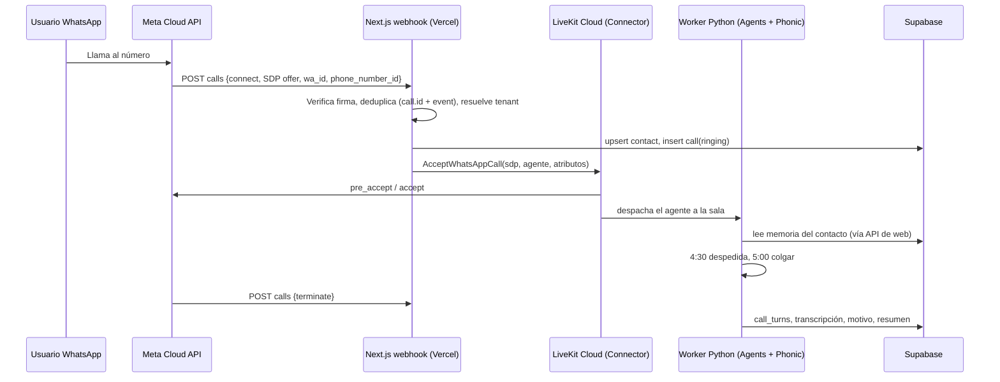

# 02 · Arquitectura

**Etiquetas:** `Confirmado` (documentación oficial revisada en la investigación de nov 2026) ·
`Por verificar` (hipótesis: **no construir sobre ella sin un spike**) · `Decisión` (nuestra, con motivo).

## 1. Resumen

Monolito modular en Next.js/TypeScript desplegado en Vercel + Supabase (Postgres multi-tenant,
Auth, Realtime, Storage) + **un worker de voz fuera de Vercel**, en un repo aparte (`pt-worker`):
Python (LiveKit Agents + plugin de Phonic).

**Por qué:** un proceso se separa solo si necesita una conexión de larga duración que Vercel no
mantiene, o está en otro lenguaje por una razón fuerte, o debe escalar/fallar de forma
independiente _ahora_. Solo la voz cumple eso. Todo lo demás son **módulos** con puertos y
adaptadores dentro de una sola app. `Decisión`

La arquitectura conserva la _forma_ de servicios (los módulos solo se hablan por su API pública)
para que una futura separación en servicios sea mecánica, pero no paga hoy su costo
(contratos de red, observabilidad distribuida, CI múltiple).

## 2. Despliegue

```
[WhatsApp usuario]
  ├─ texto / nota de voz ─► Meta webhook (messages) ─► Next.js /api/whatsapp/webhook (Vercel)
  │                              ├─ verifica firma, guarda evento crudo, responde 200 de inmediato
  │                              └─ procesa: contacto → mensaje → (STT si audio) → LLM → respuesta por Graph API
  └─ llamada ─► Meta webhook (calls: connect + SDP offer) ─► mismo endpoint en Vercel
                     └─ acepta la llamada vía LiveKit (Connector de WhatsApp) ─► LiveKit Cloud
                                    ▲
        Worker Python (LiveKit Agents + Phonic) — Fly/Railway/VPS, solo conexiones salientes
          ├─ al iniciar: lee memoria del contacto → instrucciones del agente
          ├─ temporizador: 4:30 despedida, 5:00 colgar
          └─ al terminar: guarda transcripción, duración, motivo y resumen
Supabase: Postgres + Auth + Realtime + Storage
```

Dos unidades desplegables, en dos repos: la app (repo `prueba-tecnic`, `apps/web`, Vercel) y el
worker (repo `pt-worker`, host de proceso siempre encendido, no Vercel; evitar planes gratuitos
que "duermen"). `Decisión`

## 3. Estructura del repo

```
repo/
├─ apps/
│  ├─ web/                        # Next.js
│  │  ├─ app/                     # ENTRADAS (delgadas): páginas y route.ts
│  │  ├─ components/              # UI con atomic design
│  │  │  ├─ ui/                   # shadcn (generado)
│  │  │  ├─ atoms/
│  │  │  ├─ molecules/            # EmptyState, ErrorState, LoadingState
│  │  │  └─ organisms/            # Sidebar
│  │  ├─ lib/                     # env, logger y clientes de Supabase (supabase/)
│  │  └─ modules/                 # LÓGICA: un módulo = un slice vertical
│  │     ├─ conversations/        # contactos, conversación, timeline
│  │     ├─ channels/whatsapp/    # parser de webhooks + envío por Graph API
│  │     ├─ agents/text/          # caso de uso "responder mensaje"
│  │     ├─ memory/               # ContextStore + resumen incremental
│  │     ├─ calls/                # adaptador Telephony (aceptar llamada)
│  │     └─ tenancy/              # resolver negocio por phone_number_id
├─ packages/
│  ├─ ai/                         # puertos LLM/STT + adaptadores + ProviderRouter
│  ├─ prompts/                    # prompt base y plantillas de memoria
│  └─ db/                         # tipos generados de Supabase
├─ supabase/migrations/           # esquema, RLS y funciones RPC
└─ docs/
```

Los componentes siguen atomic design (`ui` → `atoms` → `molecules` → `organisms`).

Nota: el worker de voz **no** vive en este repo; está en el repo aparte `pt-worker`.

Cada módulo: `domain/` (entidades y reglas, sin dependencias) → `application/` (casos de uso y
**puertos**) → `infrastructure/` (adaptadores) + `index.ts` (API pública). `composition.ts`
(composition root) arma los puertos con sus adaptadores.

## 4. Reglas de dependencia (se hacen cumplir con dependency-cruiser en CI)

1. `domain/` no importa infraestructura, la capa `app/`, ni paquetes npm externos.
2. `application/` no importa `infrastructure/`.
3. `app/` (entradas) no importa `modules/*/infrastructure`.
4. Un módulo solo importa a otro por su `index.ts`.
5. Librerías de proveedor (`@supabase/*`, SDK de modelos) solo en `infrastructure/` o `packages/ai`.
6. Cada tabla pertenece a un solo módulo; los demás piden los datos por su puerto.

El worker es un repo aparte (`pt-worker`); el criterio con import-linter se aplica allí: núcleo
sin dependencias, `livekit` y `phonic` solo en adaptadores. El worker **no toca la base de datos
directamente**: pide y guarda todo por HTTP a la API de la app (ver Por verificar #8). `Decisión`

## 5. Puertos principales

`LlmPort`, `SttPort`, `MessagingPort` (WhatsApp), `TelephonyPort` (aceptar/terminar llamada),
`ContextStore` (memoria), `ToolRegistry` y `ProviderRouter` (implementa `LlmPort` con una lista
priorizada de proveedores, timeouts, reintento con jitter ante 429/5xx y circuit breaker).

## 6. Flujo de llamada entrante (ruta primaria, **Por verificar**)



## 7. Flujo de texto y notas de voz

Webhook → verificar firma sobre el cuerpo crudo (comparación en tiempo constante) → insertar en
`webhook_events` con clave única (idempotencia) → responder 200 → procesar de forma diferida
(`after()` de Next o un cron que reprocese pendientes) → upsert del contacto y del mensaje →
si es audio: descargar media → STT → contexto (memoria + últimos N turnos) → `ProviderRouter` →
enviar respuesta por Graph API → guardar y reflejar en tiempo real en el dashboard.

## 8. Datos (resumen; el detalle irá en `03-data-model.md`)

Esquema **actual** (implementado en T0.3):

- `tenants`: `status`; `settings` sin secretos (se valida con `jsonb_has_secrets`).
- `tenant_members`: `tenant_id`, `user_id` (-> `auth.users`), `role`.
- `contacts`: `wa_id`, `phone_e164` aparte, `attributes`, `redacted_at` (con trigger
  `guard_contacts`); `UNIQUE(tenant_id, wa_id)` y `UNIQUE(tenant_id, id)`.

Multi-tenant con `tenant_id` en todas las tablas. `current_tenant()` devuelve `SETOF uuid`, es
`SECURITY DEFINER` y se basa en `auth.uid()` (opción A). `FORCE RLS` en todas las tablas; `anon`
sin acceso; policies solo para `authenticated`. El worker no tiene credenciales de base de datos;
la API usa `service_role` solo en servidor y con `tenant_id` explícito.

**Plan (no implementado):** `whatsapp_numbers` (`phone_number_id` único), `conversations`,
`timeline_items` (índice `conversation_id, occurred_at DESC, id DESC`), `messages` (`wamid` único),
`calls` (`wa_call_id` único; motivo de término), `call_turns`, `contact_memory`,
`webhook_events`, y opcionalmente `business_hours` y `appointments`.

## 9. Memoria compartida texto ↔ voz

Se inyecta igual en el prompt del LLM de texto y en las instrucciones de la sesión de voz: reglas
del negocio + resumen acumulado del contacto (≤ 300 palabras) + hechos clave + últimos 12–20 turnos
de la línea de tiempo mixta. Se actualiza al terminar cada llamada y tras cada intercambio de
texto (con debounce). Resumen incremental: el costo no crece con la historia. Actualización con
bloqueo optimista (`version`). No se usan embeddings. `Decisión`

## 10. Proveedores y fallback

- **LLM de texto:** primario pagado de bajo costo + secundario de otro proveedor + terciario
  gratuito, detrás del `ProviderRouter`. No depender solo de tiers gratuitos para una semana 24/7.
  `Decisión`
- **STT de notas de voz:** si el LLM primario acepta audio, enviarlo directo; si no, un servicio de
  transcripción. Siempre guardar la transcripción. `Decisión`
- **Voz:** Phonic. Un modelo de voz speech-to-speech no se puede cambiar a mitad de llamada, así
  que el respaldo es **al arrancar**: reintentar una vez y, si falla, despedida breve + mensaje de
  texto de seguimiento por WhatsApp. `Decisión`
- **Tope de 5 min:** lo controla el worker (despedida a 4:30, colgar a 5:00); el límite de duración
  de Phonic solo se usa como red de seguridad. `Decisión`

## 11. Hechos confirmados y puntos por verificar

### Confirmado (documentación oficial, nov 2026)

- Meta: la llamada entrante llega como webhook `calls` con un SDP offer; se responde con
  `pre_accept` y luego `accept` (SDP answer) por Graph API; hay unos 30–60 s para aceptar; medios
  WebRTC con Opus; las llamadas vienen **deshabilitadas por defecto** en números de prueba; las
  iniciadas por el usuario funcionan donde esté disponible la Cloud API; solo se soportan
  dispositivos iPhone y Android; las llamadas iniciadas por el negocio no están disponibles en EE. UU.
- Meta: cada webhook trae `X-Hub-Signature-256` (HMAC-SHA256 del cuerpo crudo con el app secret);
  Meta reintenta si no recibe 200, por lo que habrá duplicados.
- Phonic: integración por WebSocket, webhooks y plugin de LiveKit; español soportado; voces con
  acento mexicano `roberto` y `eduardo`; plan Starter a $0.07/min con 10 llamadas concurrentes;
  `max_conversation_duration_sec` cierra con código 4505 (corte abrupto, no despedida);
  al arrancar pueden aparecer cierres 4004, 4010 y 4429 ("reintentar más tarde").
- Groq retiró `llama-3.1-8b-instant` y `llama-3.3-70b-versatile` de las cuentas gratuitas el 16 de
  agosto de 2026. Los cupos gratuitos de Gemini publicados por terceros se contradicen entre sí.
- Supabase Free pausa los proyectos tras 1 semana de inactividad.

### Por verificar (con su spike)

| #   | Hipótesis                                                                                                                                                                        | Se cierra en        |
| --- | -------------------------------------------------------------------------------------------------------------------------------------------------------------------------------- | ------------------- |
| 1   | Tenemos acceso al **Connector de WhatsApp de LiveKit** (podría requerir solicitud de acceso)                                                                                     | Slice 02            |
| 2   | El paquete de servidor de LiveKit expone el método para aceptar la llamada de WhatsApp                                                                                           | Slice 02            |
| 3   | Una llamada desde un celular mexicano llega al número de prueba (riesgo de restricciones por país en números de prueba de EE. UU.)                                               | Slice 01–02         |
| 4   | Formato del `wa_id` de los evaluadores (52 contra 521) y que la lista de destinatarios lo acepte                                                                                 | Slice 01            |
| 5   | Phonic por LiveKit entrega la transcripción turno por turno; los post-call webhooks pueden no emitirse para conversaciones por LiveKit/WebSocket (diseñar sin depender de ellos) | Slice 04            |
| 6   | `after()` de Next en Vercel es confiable para el procesamiento diferido (si no, cron que reprocese `webhook_events`)                                                             | Slice 01            |
| 7   | Los 10 concurrentes de Phonic Starter cuentan conexiones abiertas o minutos activos                                                                                              | Slice 07            |
| 8   | El worker puede obtener y guardar datos solo por HTTP a `apps/web` con latencia aceptable (< ~800 ms en lecturas). El worker es repo `pt-worker`                                 | Slice 04            |
| 9   | Grabación y transcripción de llamadas: política de Meta no revisada                                                                                                              | Antes de la entrega |
| 10  | Soporte UDP/puertos del host elegido para el worker (solo importa si se usa la ruta de contingencia)                                                                             | Solo si falla #1    |

### Ruta de contingencia (solo si #1 falla)

WebRTC directo con el transporte de WhatsApp de Pipecat en un VPS con IP pública y TURN, con un
puente propio hacia Phonic por WebSocket. Es más código de medios; no se construye de antemano.

## 12. Hoja de ruta de slices (cada uno termina desplegado y demostrable)

| Slice                          | Entregable demostrable                                        | Prioridad                  |
| ------------------------------ | ------------------------------------------------------------- | -------------------------- |
| 00 Esqueleto                   | URL con login y página protegida de contactos                 | Obligatorio                |
| 01 Texto entrante sin IA       | Escribes por WhatsApp y el contacto aparece en el dashboard   | Obligatorio                |
| 02 Llamada contestada ("hola") | Llamas, escuchas un saludo, la llamada aparece con duración   | Obligatorio (mayor riesgo) |
| 03 IA de texto                 | Conversas con el asistente en español de México               | Obligatorio                |
| 04 Voz con Phonic              | Llamada completa con transcripción, resumen y tope de 5 min   | Obligatorio                |
| 05 Memoria compartida          | Llamas y luego escribes, y el asistente ya sabe               | Obligatorio                |
| 06 Notas de voz                | Mandas un audio y recibes respuesta con transcripción visible | Recomendable               |
| 07 Confiabilidad               | Fallback de modelos, 2 llamadas simultáneas, healthcheck      | Obligatorio                |
| 08 Negocio configurable        | Un segundo negocio con otro tono y otro número                | Obligatorio                |
| 09 Pulido del dashboard        | Búsqueda, paginación, tiempo real, estados                    | Recomendable               |
| 10 Agenda por herramientas     | El asistente agenda por voz y por texto                       | Opcional                   |
| 11 Kanban                      | Vista por etapas                                              | Opcional                   |
| 12 Entrega                     | README, secret rotado, audio, checklist final                 | Obligatorio                |

## 13. Descartado para esta prueba y por qué

- **Asterisk / SIP / LiveKit SIP:** no hay troncal PSTN; la llamada ya llega como WebRTC desde Meta.
  SIP exige app en modo Live, servidor con TLS y deshabilita los webhooks de llamadas de la Graph
  API. Se conserva para Caliope, no para esta prueba.
- **Microservicios, NATS, gRPC, sagas, outbox:** el costo de operarlos no se compensa con un
  beneficio visible para el evaluador.
- **LangGraph y cascada STT→LLM→TTS:** la conversación es libre y la conduce Phonic.
- **RAG y embeddings:** el cuello de botella es el contexto del LLM y lo resuelve el resumen
  incremental más la ventana de turnos.
- **Depender solo de tiers gratuitos** para la semana de evaluación.
